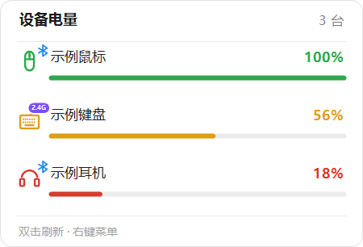
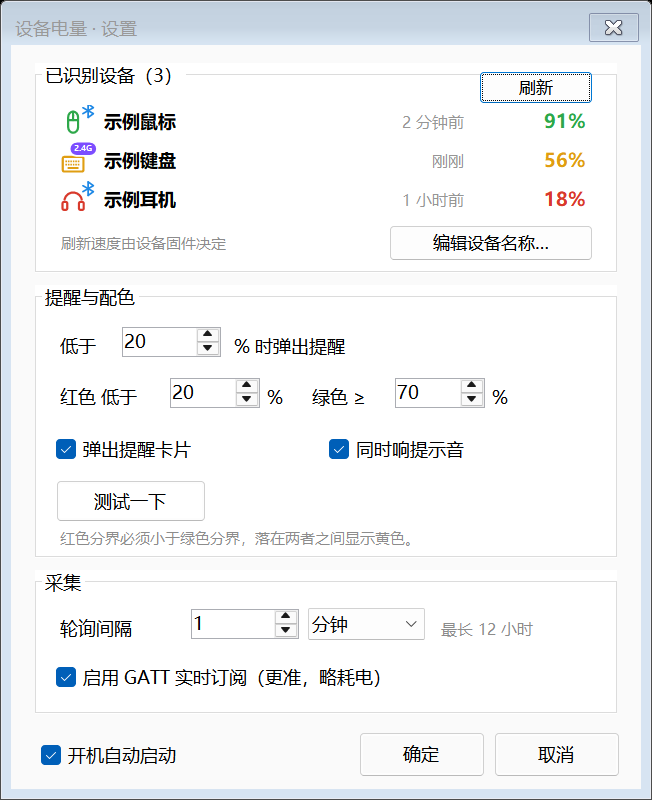

# 设备电量

Windows 任务栏托盘工具，实时显示蓝牙设备（鼠标 / 键盘 / 耳机 / 手柄）的电量，并支持部分 2.4G 接收器。

[**下载最新版**](https://github.com/H1p/bluetooth-battery-tray/releases/latest)　·　Windows 10 2004+ / 11（64 位）　·　免安装、免运行时，双击即用

- **一个图标** —— 托盘常驻单图标，显示电量最低的已连接设备，颜色按电量分档
- **悬停看全部** —— 鼠标停上去弹出卡片，逐行列出现有设备
- **低电量提醒** —— 低于阈值时右下角弹提醒卡片，可选提示音
- **双模合并** —— 同一台设备在蓝牙与 2.4G 之间切换只显示一条，图标角标标示当前连接方式



## 使用

双击 `MouseBattery.exe`，任务栏出现图标即可，无需安装、不留后台服务。

| 操作 | 效果 |
|---|---|
| 鼠标停在图标上 | 弹出卡片，列出全部设备 |
| 双击图标 | 立即刷新全部设备 |
| 右键图标 | 设置、编辑设备名称、开机自启、退出 |

设备需**先在系统里配对并连接**。本工具只读取电量，不负责搜索和配对。

## 设置



- **设备列表** —— 图标 · 名称 · 最近更新时间 · 电量；右上角「刷新」立即重读，不必等轮询
- **低电量阈值** —— 默认 20%
- **颜色分界** —— 默认红色 < 20%、绿色 ≥ 50%，中间为黄色
- **轮询间隔** —— 默认 30 秒，单位可选秒 / 分钟 / 小时，最长 12 小时
- **GATT 实时订阅** —— 默认开启，设备一上报就刷新
- **编辑设备名称** —— 给设备起个自己认得的名，留空即恢复原名

## 数据来源

按优先级自动择优：

1. **BLE GATT**（服务 `0x180F` / 特征 `0x2A19`）—— 主动读取并订阅推送
2. **系统属性** `DEVPKEY_Bluetooth_Battery` —— GATT 不可用时兜底
3. **厂商私有 HID** —— 仅 2.4G 接收器，见下节

刷新速度的上限由设备固件决定：多数设备只在刚连上或电量变化时上报一次，软件无法突破。数字长时间不变通常是设备还没报告新值，不是没在工作。

## 2.4G 接收器

2.4G 接收器在系统里没有电量属性，只能走厂商私有协议。目前实现了一种：

| 项 | 值 |
|---|---|
| 方案 | 贝盈 bytech |
| HID 集合 | `usagePage 0xFF1C`，64 字节收发，report ID `0x04` |
| 请求 | `04 · 00 00 1A 06 00 00 00`（补零到 64 字节） |
| 响应 | 同样前缀 + 电量字节 |

实现时踩过的坑，改这块前必看：

- 必须用 `WriteFile` 写入，`HidD_SetOutputReport` 会被设备拒绝（回 `0xAA`）
- 读写分开两个句柄：读带 `FILE_FLAG_OVERLAPPED`，写不能带（否则 `ERROR_INVALID_PARAMETER`）
- 先挂读再写帧，否则很快返回的响应会漏掉
- 接收器**不会周期推送**，只能主动查询

每家厂商的 2.4G 协议都不一样——HID 集合、帧头、命令码、电量位置全不同，甚至同一家的键盘和鼠标也不同。要支持新设备，得在 `Wireless24G.cs` 里单独适配。

## 兼容性

- Windows 10 2004 (Build 19041) 及以上，或 Windows 11；仅 64 位
- 已适配高 DPI 缩放
- **不支持经典蓝牙（BT 3.0）设备**：这类设备不暴露电量，系统本身也读不到

## 构建

需要 .NET 8 **SDK**（不是 Runtime）。

```bat
:: 精简版：依赖 .NET 8 Desktop Runtime，约 25 MB
dotnet publish -c Release -o dist

:: 便携版：自包含单文件，约 69 MB，对方无需装任何运行时
dotnet publish -c Release -r win-x64 --self-contained true ^
  -p:PublishSingleFile=true ^
  -p:EnableCompressionInSingleFile=true ^
  -p:IncludeNativeLibrariesForSelfExtract=true ^
  -p:DebugType=none ^
  -o dist-portable
```

`IncludeNativeLibrariesForSelfExtract` 不能省，否则原生 DLL 会散落在 exe 外面，就不再是单文件了。

## 文件位置

| 路径 | 说明 |
|---|---|
| `%LOCALAPPDATA%\MouseBattery\settings.json` | 配置。不跟 exe 走，换版本或换目录都不会丢，旧位置会自动迁移 |
| `MouseBattery.log` | 运行日志，与 exe 同目录 |

## 诊断命令

```
MouseBattery.exe --dump            # 设备枚举与合并结果 → dump.txt
MouseBattery.exe --hover-preview   # 渲染悬停卡片 → hover-preview.png
MouseBattery.exe --settings-shot   # 渲染设置窗口 → settings-shot.png
MouseBattery.exe --iconsheet       # 各电量档位图标放大图
```

## 项目结构

| 文件 | 职责 |
|---|---|
| `Program.cs` | 入口、单实例互斥、DPI 初始化、诊断模式 |
| `TrayContext.cs` | 托盘图标、右键菜单、轮询调度、低电量判定 |
| `HoverCard.cs` | 悬停卡片，自绘、不抢焦点、自动收起 |
| `BatteryMonitor.cs` | 采集层：GATT 通道、系统属性兜底、2.4G 合并 |
| `Wireless24G.cs` | 2.4G 私有 HID 协议 |
| `DevProp.cs` | SetupAPI P/Invoke，枚举 BLE 设备并读电量属性 |
| `BatteryIcon.cs` | 托盘图标绘制与电量配色 |
| `DeviceIcons.cs` | 设备类型图标、类型识别、连接方式角标 |
| `SettingsForm.cs` | 设置窗口，布局按 96 DPI 基准缩放 |
| `DeviceNameForm.cs` | 编辑设备名称 |
| `PopupNotice.cs` | 右下角低电量提醒卡片 |
| `AppSettings.cs` | 配置读写、旧配置迁移、参数归一化 |
| `build.cmd` | 一键产出两个构建版本 |

无第三方 NuGet 依赖，只用 .NET 8 自带的 WinForms 与 WinRT（`net8.0-windows10.0.19041.0`）。

## 两点实现取舍

**为什么用自绘卡片而不是系统工具提示**：`NotifyIcon.Text` 上限 63 字符且不支持换行，多设备列表塞不进去。

**为什么提醒不用系统气泡**：Windows 11 要求程序向通知中心注册 AppUserModelID，未注册的裸 exe 调用会被静默丢弃。改成自绘卡片后任何环境都保证可见，也能顺带画出电池图形和告警配色。

## 许可证

[MIT](LICENSE)
